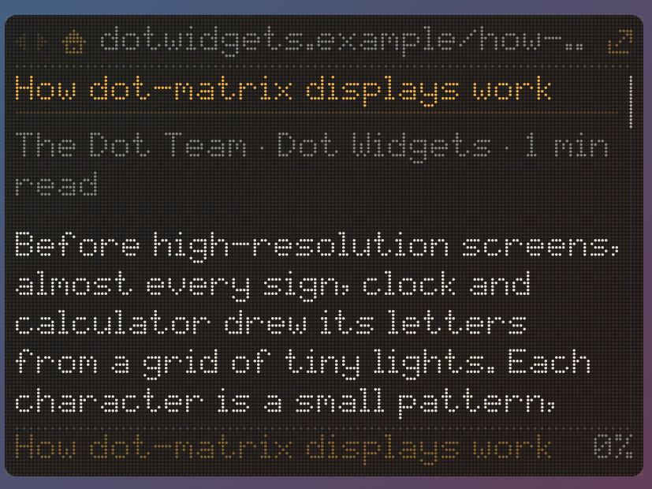

# Dot Reader

A dot-matrix reading-mode browser for Windows and macOS. Type a web address and the page opens as just its words, drawn in dots, with proper upper and lower case. It's from the same family as [Dot Clock](https://github.com/slainbya-dotcom/dot-clock) and the other Dot widgets.

<!-- Add a screenshot as docs/images/widget.png and uncomment:  -->

## What it does

- **Address bar:** click the address at the top, or press Ctrl+L (Cmd+L on a Mac), type a web address and press Enter. Typing words instead searches the web.
- **Reading mode:** the page is cleaned up the way Firefox's Reader View does it, keeping:
  - the title, author and reading time
  - headings, paragraphs and links
  - bullet and numbered lists, quotes and code
  - image captions

  Menus, adverts and cookie banners are dropped.
- **Dot text:** capitals and digits are the family's 5×7 letters. Lower case is a new set with two extra rows, so g, j, p, q and y dip below the line. Accents and "smart quotes" are cleaned up so they always draw.
- **Links:** blue and underlined, and they brighten under the mouse while the bottom line shows where they go. Click one to follow it.
- **Getting around:**
  - ◂ ▸ (or Backspace, Alt+←/→, and the mouse's back/forward buttons) go back and forward.
  - The house goes to your home page.
  - The ↗ arrow opens the page in your normal browser.
- **Scrolling:** mouse wheel, arrow keys, Page Up/Down, Space (Shift+Space goes up), and Home/End. A bar on the right and a percentage show where you are.
- **Its own size:** width and height are set separately in settings and don't follow Dot Clock. You can also change the dot size, heading and text colours (presets: amber, green, white, blue), dot shape and background.
- **Home page:** set one, or have it reopen the last page you were reading.

## What works well, and what doesn't

**Works well:** articles, blogs, news (without a paywall), recipes, documentation and Wikipedia.

**Not suitable:** web apps such as email, video, maps or social media, pages behind a login or paywall, and sites that build their pages with JavaScript. Dot Reader shows what it can find, and the ↗ arrow opens the page in your browser.

## Privacy and safety

Pages are downloaded by the app and read as plain data. Their scripts never run, images aren't downloaded, and nothing on the page can reach your computer. Searches go to DuckDuckGo.

## Where it lives

The widget doesn't take up a spot on the taskbar (or the Dock on a Mac). It sits in the **system tray** (the menu bar on a Mac) instead. Left-click the tray icon to bring the widget forward, and right-click it to show or hide the widget, open settings, move the widget to the centre of the screen, or quit.

## Building it yourself

See [BUILDING.md](BUILDING.md). The installer is called `Dot Reader_1.0.0_x64_en-US.msi`.

Reading mode uses [Mozilla Readability](https://github.com/mozilla/readability) (Apache License 2.0). It's installed by `npm install` and copied into the app when it's built.
